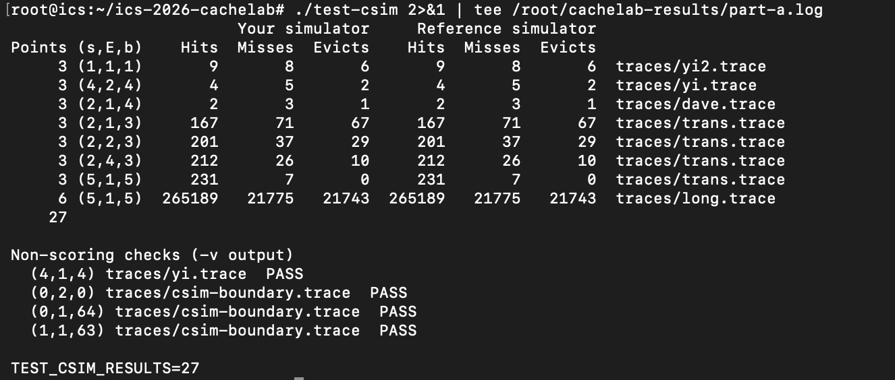
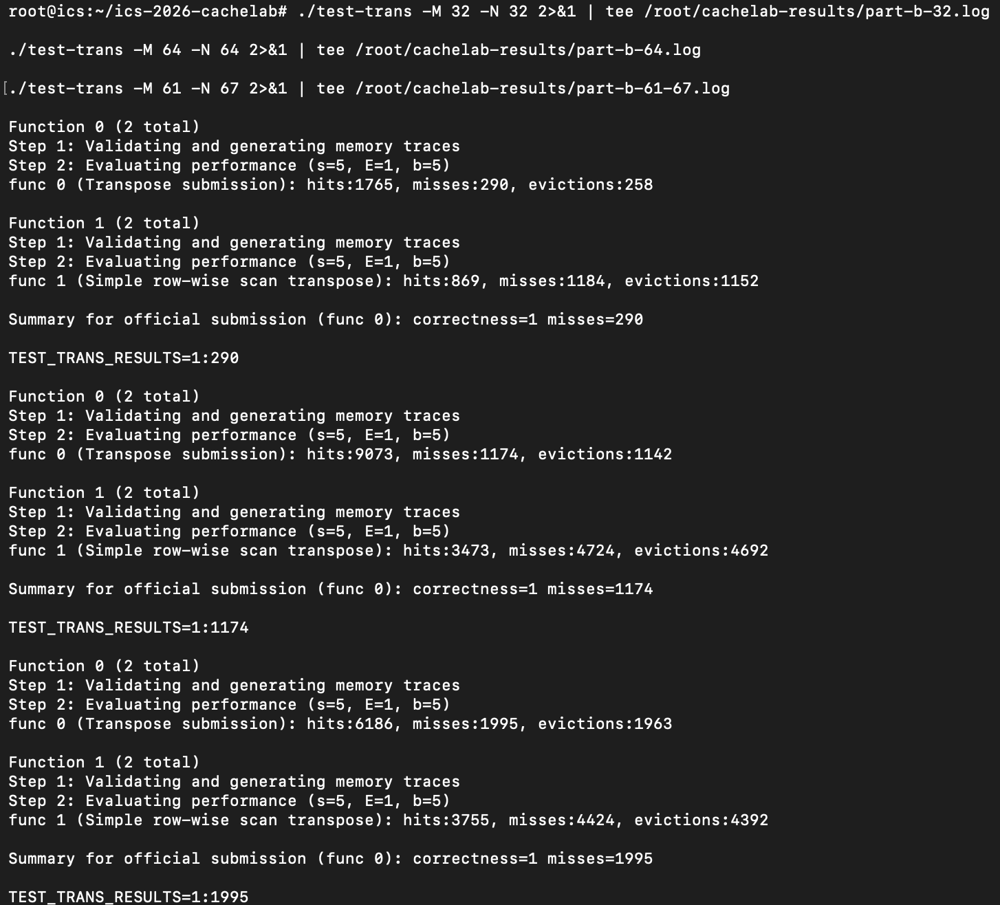
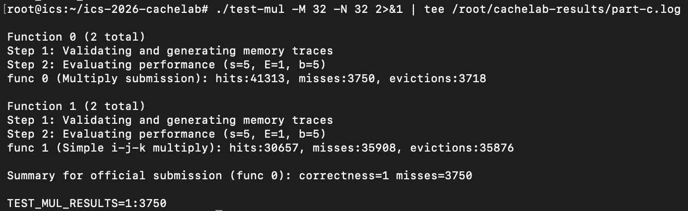
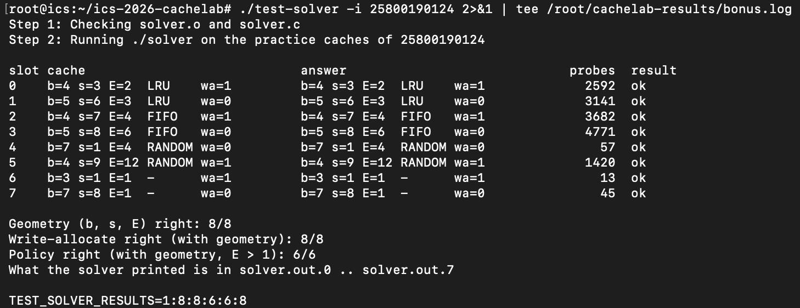

# Lab4：Cache Lab 实验报告

刘秉毅   25800190124

## Part A：LRU 缓存模拟

Part A 需要实现一个支持 LRU 替换策略的缓存模拟器。为此，本文在每行结构体中维护了有效位 `valid`、标记位 `tag` 以及最近访问时间戳 `last_used`。每次访存时，先在对应组内遍历查找有效且 `tag` 匹配的缓存行；若未命中，则优先填入空闲行，只有当组内所有行都有效时，才挑出 `last_used` 最小的那一行进行替换，并同时累加 `miss` 和 `eviction`。

同时，拆分 64 位地址时，先右移 $b$ 位得到块号，再用位掩码取低 $s$ 位作为组索引，剩余高位作为 `tag`。这里有个边界细节：当 $b=64$ 时，在 C 语言中对 64 位无符号整数直接右移 64 位属于未定义行为，因此单独判断令块号为 0；而 $s=0$ 时掩码自然为 0，无需额外特判：

```c
uint64_t block = b == 64 ? 0 : addr >> b;
size_t set = block & (((uint64_t)1 << s) - 1);
uint64_t tag = block >> s;
```

每次访问将递增 `tick`，命中或装入新行时更新 `last_used`。淘汰同时增加 miss 和 eviction。模板跳过 `I`，将 `M` 转为同一地址的两次访问。由于在 C 语言中，对 64 位整数右移 64 位属于未定义行为，所以本文将 `b=64` 单独处理；`s=0` 时没有组索引位，组索引为零。

例如，两路组内依次访问块 `0,1,0,2`，第三次访问刷新块 0 的时间戳，第四次应淘汰块 1。单次访问时间为 $O(E)$，状态空间为 $O(2^s E)$。

## Part B：矩阵转置

评测使用的模拟器是 1 KiB 直接映射缓存（32 组、每块 32 字节，即每行可存 8 个 `int`）。转置时，A 的连续读取与 B 的跨行写入容易相互干扰，因此我们可以按行跨度选择不同的分块方式。

| 尺寸 | 实现策略 | 目的 |
|:---|:---|:---|
| 32×32 | 8×8 分块，先读一行再写 B | 避免输出写入打断输入读取 |
| 64×64 | 8×8 分块，内部按 4×4 象限交换 | 减少输出上下四行的组冲突 |
| 61×67 | 16×16 分块，检查行列边界 | 兼顾局部性与边缘处理开销 |

对 32×32，由于模板中 `A` 和 `B` 的起始地址对缓存大小同余，对角线元素 `A[i][i]` 与 `B[i][i]` 会映射到同一缓存组，交替读写容易互相驱逐。故使用 `a[8]` 先读完 A 的一行，再写回 B：

```c
for (int c = 0; c < 8; ++c)
    a[c] = A[r][j + c];
for (int c = 0; c < 8; ++c)
    B[j + c][r] = a[c];
```

对64×64 ，其行跨度为 256 字节，组号每行增加 8，因此同列元素每隔 4 行就会落入同一组，普通 8×8 分块内部仍会发生严重冲突。此时不妨将块写成 $[[P, Q], [R, S]]$，转置目标为 $[[P^T, R^T], [Q^T, S^T]]$。那么就可以先写 $P^T$，将 $Q$ 暂存在 B 中未来放 $R^T$ 的位置；再读取 $R$ 和暂存值，分别写入 $R^T$ 与 $Q^T$ 的最终位置，最后完成 $S^T$。交换时先读后写，避免覆盖尚未归位的数据。

对61×67 ，其行跨度不规则，采用 16×16 分块并加上边界判断。与逐行转置的对比测试中，misses 从 4424 降到 1995。

## Part C：矩阵乘法

朴素的 `i-j-k` 三重循环在最内层跨行读取 `B`，空间局部性差。本文采用 3×4 寄存器分块：每次计算 `C` 中一个 3×4 子块，用局部数组 `sum[3][4]` 充当 12 个累加器。因此在内层遍历 `k` 时，可以先把 `B[k][j..j+3]` 这 4 个连续元素读入局部变量，再复用于计算 3 行输出，全部累加完后再统一写回 `C`：

```c
int b0 = B[k][j], b1 = B[k][j + 1];
int b2 = B[k][j + 2], b3 = B[k][j + 3];
for (int r = 0; r < 3 && i + r < N; ++r) {
    sum[r][0] += A[i + r][k] * b0;
    sum[r][1] += A[i + r][k] * b1;
    sum[r][2] += A[i + r][k] * b2;
    sum[r][3] += A[i + r][k] * b3;
}
```

在选择 3×4 输出块后，12 个累加器加 4 个 B 值恰好用满 16 个变量的额度。对于32×32 ，A 的三行共 96 个 `int`，占 12 个缓存行，映射到 32 组中的 12 个不同组，因此三行之间不会自驱逐。若固定这三行遍历 B 的不同列块，则可以让 A 的数据尽量留在缓存里反复复用；B、C 的访问仍可能替换其中的缓存行。B 的四个值预先存入局部变量后，即使相应缓存行被逐出，也能继续复用。

对于底部不足 3 行、右侧不足 4 列的边缘区域，分别用 `i + r < N` 和单独循环收尾。所有累加器均从 0 开始计算并直接覆盖 `C`，不依赖 `C` 的随机初值，也不修改 `A`、`B`。运算量仍为 $O(N^2 M)$，misses 从基线的 35908 降到 3750（减少约 89.6%）。

## Bonus：从命中反馈推断缓存参数

Bonus 要求仅凭探测函数的命中反馈反推出缓存的几何参数与策略。为了避免未知参数互相干扰，本文按 $b \rightarrow E \rightarrow s \rightarrow \text{写分配} \rightarrow \text{替换策略}$ 的顺序逐步确定：

| 参数 | 探测方法与依据 |
|:---|:---|
| $b$ | 载入地址 0，再读 $2^0$、$2^1$、…，首次缺失时跨过块边界 |
| $E$ | 以 $2^{b+9}$ 为步长，保证所有块同组；增加块数并原序复读，求可全部命中的最大数量 |
| $s$ | 固定 $E+1$ 个块，测试步长 $2^{b+i}$；首次无法全部容纳时 $i=s$ |
| 写分配 | 清空后写地址 0，再读地址 0，命中表示写缺失调入了该块 |
| 替换策略 | 填满一组，命中最早装入块，引入新块，再回读第二块；重复探测区分 RANDOM |

为了让几何参数的判断不依赖替换策略，我把“这些块能否全部留在缓存中”的判断写成了辅助函数 `all_fit`：

```text
all_fit(stride, n):
    清空缓存
    依次读取 stride * 0, ..., stride * (n - 1)
    按相同顺序再读一次
    第二轮全部命中则返回真，否则返回假
```

若第二轮全部命中，则等价于第一轮结束时所有块都在缓存中。若有块不在，第二轮最早遇到的缺失块在此之前尚未重新装入，必然暴露一次 miss，所以该判定适用于三种替换策略。测试 $s$ 时，$i < s$ 会将 $E+1$ 个块分到至少两组，每组不超过 $E$ 个；$i = s$ 时所有块同组，超过容量便出现缺失。

区分替换策略时，以 $E=4$ 为例（用 `0~4` 代表映射到同一组的不同块）：先访问 `0, 1, 2, 3, 0` 填满该组并刷新块 0，此时 LRU 的淘汰序为 `1, 2, 3, 0`，而 FIFO 仍为 `0, 1, 2, 3`；接着访问新块 `4`，LRU 会淘汰块 `1`，FIFO 会淘汰块 `0`。因此最后回读块 `1` 时，LRU 必定缺失，FIFO 必定命中：

| 访问阶段 | LRU | FIFO |
|:---|:---|:---|
| 装满 0、1、2、3 后命中 0 | 0 成为最近使用块 | 装入顺序不变 |
| 读入新块 4 | 淘汰块 1 | 淘汰块 0 |
| 再读取块 1 | 缺失 | 命中 |

若采用RANDOM 策略，那么每轮最后读取块 1 的缺失概率为 $1/E$，代码中最多重复探测 512 轮，出现命中和缺失两种结果即可判为 RANDOM。在均匀随机替换的假设下，误判概率为 $(1/E)^{512} + (1 - 1/E)^{512}$；$E \le 16$ 时低于 $4.5 \times 10^{-15}$，足以稳定区分。当然，$E=1$ 时，发生替换时各策略都只能淘汰这一行，行为完全一致，因此不计分。每轮探测最多 $E+3$ 次访问，策略阶段上限为 $512 \times 19 = 9728$ 次；加上其余探测，总计不足 11000 次，低于 1000000 次预算。额外 150 组参数测试均通过，最大探测次数为 10281。

## 运行结果与复现

环境为 x86_64 Linux、GCC 13.3、Valgrind 3.22，使用模板 Makefile。在仓库根目录执行：

```bash
make clean && make
python3 driver.py -i 25800190124
```

| 用例 | 基线 misses | 本实现 misses | 满分阈值 | 得分 |
|:---|---:|---:|---:|---:|
| 32×32 转置 | 1184 | 290 | 300 | 12/12 |
| 64×64 转置 | 4724 | 1174 | 1300 | 12/12 |
| 61×67 转置 | 4424 | 1995 | 2000 | 16/16 |
| 32×32 乘法 | 35908 | 3750 | 3999 | 25/25 |

总评测得分为 **110.000/110**。

## 运行截图








